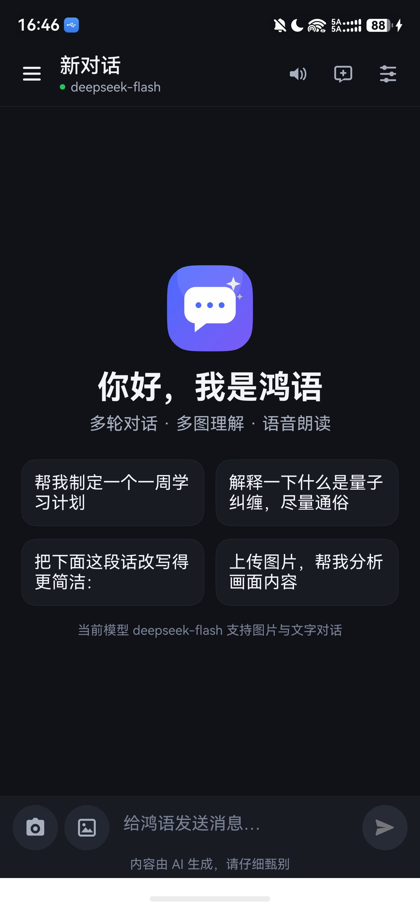
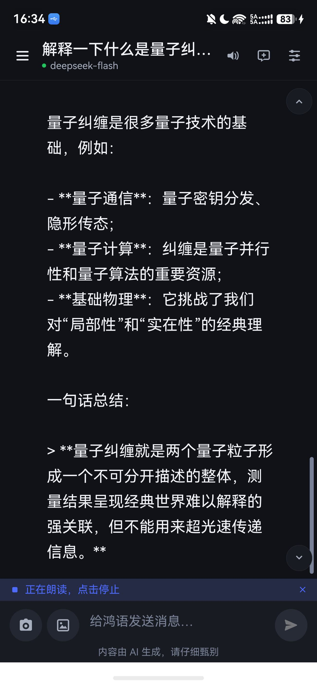
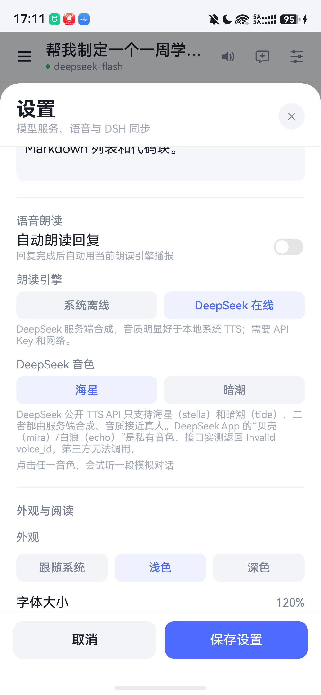

# 鸿语 · HarmonyOS AI 助手

[](LICENSE)

一个面向 HarmonyOS NEXT 的原生 ArkTS AI 聊天应用，**默认接入 DeepSeek 官方 API**。
交互参考 DeepSeek App：左侧/抽屉式多会话列表、连续多轮对话、一次最多 9 张图片上传、
系统相机拍照、DeepSeek 聊天记录导入、回复语音朗读，同时兼容任意 OpenAI Chat Completions 接口。
项目还附带一个 **DeepSeek Harness 同步插件**，可在同一局域网内与手机双向同步文字对话。


> **重要说明**
> - 本项目是第三方 DeepSeek API 客户端，**不是 DeepSeek 官方应用**，与 DeepSeek 官方无隶属关系。
> - 使用前需要在应用内填写你自己的 DeepSeek API Key，费用由你的 DeepSeek 账号承担。
> - 仓库**不包含任何 API Key、签名证书、私钥或密码**；`build-profile.json5` 已移除签名配置，请使用 DevEco Studio 自动签名或配置你自己的证书。
> - “贝壳/白浪”是 DeepSeek App 私有音色，公开 TTS API 不提供；本项目使用官方公开的海星/暗潮和系统离线音色。
> - **下载、安装、使用本软件造成的任何损失由使用者自行承担**，详见 [DISCLAIMER.md](DISCLAIMER.md)。

## 界面预览

| 欢迎页 | 长对话与朗读 | 浅色主题 |
| --- | --- | --- |
|  |  |  |

## 功能

- **DeepSeek API**：默认使用 `https://api.deepseek.com` + `deepseek-flash`，设置中可切换 `deepseek-v4-pro`；内置“测试 DeepSeek API 连接”，可在保存前验证 Key、模型和网络。
- **多会话管理**：新建、切换、删除对话；长按侧栏对话可**重命名、置顶/取消置顶、删除**；会话与消息保存在本机，重启后自动恢复；置顶对话始终排在最前。空白“新对话”只作为当前草稿，不进入历史列表；删除最后一个对话后列表保持为空，发送消息时再自动创建新对话。
- **连续对话**：按会话保存上下文，自动生成会话标题，限制最近 40 条消息作为上下文，控制请求体大小。
- **多图上传**：系统图库选择器一次可选多张，最多 9 张；自动压缩为最长边 1280 px 的 JPEG，显示缩略图并支持全屏预览，发送前可逐张移除。
- **系统相机拍照**：通过系统 CameraPicker 拍照（无需申请相机权限），照片自动压缩后加入当前待发送图片。
  - 第一次进入相机时，HarmonyOS 会显示“安全访问相机：应用仅可访问拍摄完成的图片/视频”。这是系统隐私机制，**不是相机不可用**：点“知道了”即可继续拍照，拍完点右下角 ✓ 返回应用。
- **DeepSeek 聊天记录导入**：支持 DeepSeek 官网导出的 `deepseek_data-*.zip`（v3）、单会话 JSON、Markdown/TXT 和本 App/DSH 同步 JSON；在侧栏点“导入 DeepSeek 聊天记录”即可。
- **图片理解**：`deepseek-flash` 支持图文混合输入。App 按 OpenAI Vision 格式发送 Base64 `image_url`，无需额外文件上传接口。
- **回答长按菜单**：长按助手回复可选择 **复制 / 选择文本 / 重新生成 / 朗读或停止朗读**；重新生成会从该回答所在轮次重新请求。
- **语音朗读**：支持 **DeepSeek 服务端在线音色（海星/暗潮，接近真人）** 和 HarmonyOS Core Speech Kit 离线音色；支持手动朗读、自动朗读、随时停止（回复下方按钮、长按菜单和聊天页底部悬浮停止条）；系统音色支持语速、音量、音调。
- **外观与阅读**：可设置**跟随系统 / 浅色 / 深色**主题，字体大小 85%–130% 可调；设置保存在本机，深色模式同步更新系统状态栏。
- **对话跳转与滚动**：聊天区右侧提供“上一个/下一个对话”箭头，隐藏式纵向滚动条始终可见并可拖动，长对话可直接用滚动条定位。
- **DSH 同步**：附带 `dsh-plugin-hongyu-sync` Host 插件，在电脑上启动局域网同步桥；手机侧可测试连接、推送/拉取文字对话，DSH 侧可用 `hongyu_sync` 读取手机对话或把当前对话导出给手机。
- **会话设置**：Base URL、API Key、模型、系统提示词、温度、主题、字体、TTS 参数、DSH 同步参数均可配置；同时兼容通义千问、智谱、OpenAI 等 OpenAI 兼容接口。
- **适配手机/平板/2in1**：宽度 ≥ 760 vp 时固定显示侧栏，窄屏使用抽屉；支持系统/浅色/深色主题。

## 环境要求

| 项目 | 要求 |
| --- | --- |
| 开发工具 | DevEco Studio 5.0 及以上 |
| SDK | HarmonyOS NEXT API 12（`5.0.0(12)`） |
| 语言 | ArkTS / ArkUI（Stage 模型） |
| 运行设备 | 建议使用 HarmonyOS NEXT 真机；系统 TTS 在模拟器上通常不可用 |
| 网络 | 可访问 DeepSeek API，已声明 `ohos.permission.INTERNET` |

## 快速开始

1. 打开 DevEco Studio，选择 **Open**，打开本项目根目录（包含 `build-profile.json5` 的目录）。
2. 等待 **Sync** 完成。若提示签名未配置，进入  
   **File → Project Structure → Signing Configs**，勾选 **Automatically generate signature**，登录华为开发者账号后完成自动签名。
3. 连接 HarmonyOS NEXT 真机，点击 Run。
4. 首次打开会显示欢迎页和“先配置 API Key”提示。点击 **去设置**：
   - 点击 **DeepSeek Flash** 快捷预设；
   - 填入在 [DeepSeek 开放平台](https://platform.deepseek.com/api_keys) 创建的 API Key；
   - 点击 **测试 DeepSeek API 连接**，成功后保存设置；
   - 回到聊天页即可开始文字或图片对话。

> 本项目按 API 12 编写，使用 DevEco Studio 的集成 Hvigor 构建（无独立 hvigor-wrapper）。
> 如果使用更高的 SDK 版本，DevEco 会提示升级 `compatibleSdkVersion`，按向导升级即可。
> 交付内容是完整源码工程，不包含已签名的 HAP；需要在 DevEco Studio 中签名并安装到真机。

## 下载与安装

### 普通用户

**HarmonyOS 不能像 Android APK 一样直接点击 HAP 安装。** 公开安装的正式渠道是华为应用市场（AppGallery）：

1. 应用上架后，在华为应用市场搜索“鸿语”安装；
2. 或通过应用市场分享页/邀请测试安装。

本仓库不会提供“下载后双击即可安装”的 HAP，因为 HarmonyOS 会校验签名、Profile 和设备 UDID，普通 release HAP 无法在任意设备上侧载。

### 开发者/自用

```bash
git clone https://github.com/allwell997/HongYu-HarmonyOS-AI.git
cd HongYu-HarmonyOS-AI
```

用 DevEco Studio 打开并配置你自己的签名：

- Debug 调试：使用 DevEco 自动签名；HAP 通过 `hdc install` 安装到你已注册的设备。
- Release 上架：使用你自己的发布证书/Profile 构建 signed `.app`，上传 AppGallery。
- 不要把 `.p12`、`.cer`、`.p7b`、`.csr` 提交到仓库。

> 侧载、修改签名、使用非官方渠道安装，可能导致安装失败、数据丢失或系统安全风险，责任由使用者承担。

## 命令行构建


仓库中的 `build-profile.json5` **故意不包含任何签名配置**，避免泄露证书和密码。

Debug 构建：

```bash
devecocli build --build-mode debug
```

Release 上架包：

1. 在 AGC 创建应用并申请发布证书/Profile；
2. 在 DevEco Studio 的 **File → Project Structure → Signing Configs** 配置 `.p12`、`.cer`、`.p7b`；
3. 执行：

```bash
devecocli build --build-mode release
```

或 DevEco Studio → **Build → Build App(s)**，Build Mode 选 `release`，生成 signed `.app`。

> 不要提交 `.p12`、`.cer`、`.p7b`、`.csr`、`keys/`、`build-profile.backup.json5`。  
> 本仓库的 `.gitignore` 已忽略这些文件。

## DeepSeek API 接入

默认配置：

```text
Base URL: https://api.deepseek.com
Model:    deepseek-flash
```

App 会自动拼接为：

```text
POST https://api.deepseek.com/chat/completions
Authorization: Bearer <DEEPSEEK_API_KEY>
Content-Type: application/json
```

请求体遵循 DeepSeek 的 OpenAI 兼容 Chat Completions 格式。Base URL 填到域名一级即可，
不需要手动填写 `/chat/completions`；如果填写了完整路径，App 也会识别并直接使用。

### 当前 DeepSeek 模型

| 模型 | 适用场景 | 图片输入 |
| --- | --- | --- |
| `deepseek-flash` | 默认推荐，日常对话、图文理解、速度较快 | 支持 |
| `deepseek-v4-pro` | 更复杂的纯文本推理任务 | 不使用图片时选择 |

> 官方已用 `deepseek-flash` / `deepseek-v4-pro` 取代旧的 `deepseek-chat` / `deepseek-reasoner`。
> 如果服务端返回 404，请优先检查模型名是否与当前官方文档一致，具体以 [DeepSeek API 文档](https://api-docs.deepseek.com/) 为准。

### 图片请求格式

最后一条用户消息带图片时，App 发送如下结构（其他历史消息中的图片不再重复上传，只保留文字说明）：

```json
{
  "model": "deepseek-flash",
  "messages": [
    {
      "role": "user",
      "content": [
        { "type": "text", "text": "帮我看看这张图" },
        {
          "type": "image_url",
          "image_url": { "url": "data:image/jpeg;base64,..." }
        }
      ]
    }
  ],
  "stream": false
}
```

- 图片先在设备上压缩为最长边 1280 px 的 JPEG，再转 Base64，单张通常在几百 KB 以内。
- 一次最多 9 张；DeepSeek 单次请求支持更多图片，但控制数量可以降低流量和等待时间。
- 需要保证当前模型是 `deepseek-flash` 或其他支持视觉的模型；`deepseek-v4-pro` 建议只发文字。

### 自定义兼容接口

除了 DeepSeek 官方 API，也可以填写任何兼容 OpenAI Chat Completions 的接口，例如：

- 通义千问：`https://dashscope.aliyuncs.com/compatible-mode/v1` + `qwen-vl-max`
- 智谱：`https://open.bigmodel.cn/api/paas/v4` + `glm-4v-plus`
- OpenAI：`https://api.openai.com/v1` + `gpt-4o`

自定义接口时，App 仍会自动补 `/chat/completions`。

## 导入 DeepSeek 聊天记录

在应用侧栏点击 **导入 DeepSeek 聊天记录**，选择文件后导入到本地会话列表：

1. 在 [chat.deepseek.com](https://chat.deepseek.com) 导出全部聊天记录，得到 `deepseek_data-*.zip`；
2. 可以直接选择这个 ZIP，App 会解压并读取 `manifest.json`、`chat_session_index.json` 和 `chat_sessions/*.json`；
3. 按 `current_message_id` 与 `parent_id` 还原对话分支，提取 `REQUEST` 与 `RESPONSE` 文本，忽略思考、工具卡片和模板内容；
4. 最多导入最近 100 个对话，已存在的同 ID 对话不会重复导入。

也支持：

- 单会话 JSON（`chat_sessions/<id>.json`）；
- App / DSH 同步 JSON（数组或 `{ "conversations": [...] }`）；
- Markdown / TXT，按 `User:`、`Assistant:`、`用户：`、`助手：`、`## User` 等角色标记拆分。

限制：

- 导出 ZIP 上限 200 MB，解压后的临时文件放在缓存目录并在导入完成后清理；
- 只导入文字，DeepSeek 导出包中的图片不会复制到手机，消息中可能没有图片；
- 导入在主线程完成，特别大的导出包可能需要等待。

## 拍照与图片

- 输入框左侧新增相机按钮，点击后调用系统 `CameraPicker` 拍照，无需申请 `ohos.permission.CAMERA`。
- 拍照结果与图库选择结果走同一套压缩流程：最长边 1280 px、JPEG 质量 82，然后加入待发送图片列表。
- 一次最多 9 张，可混合“相册选择”和“拍照”。

## 手势、外观与滚动

- **长按对话**：在侧栏对话列表长按任意对话，弹出“重命名 / 置顶（或取消置顶）/ 删除”菜单。
- **长按回答**：长按助手回复弹出“复制 / 选择文本 / 重新生成 / 朗读（或停止朗读）”。选择文本会打开可长按选词并可复制全文的浮层。
- **停止朗读**：回复下方按钮、长按菜单和聊天页底部的“正在朗读，点击停止”悬浮条都可以随时停止。
- **外观**：设置 → 外观与阅读，可选跟随系统、浅色、深色；点击主题会**立即切换并保存**。字体大小可调 85%–130%，保存设置后生效。
- **对话跳转**：聊天内容右侧上方/下方箭头分别跳转到上一个/下一个对话；中间始终显示的纵向滚动条可拖动查看长对话。

## DeepSeek Harness 插件与同步

插件源码在 [`dsh-plugin-hongyu-sync`](dsh-plugin-hongyu-sync/README.md)，当前已在 DSH profile 中安装并启用。它提供：

- 本机局域网 HTTP 服务，默认 `0.0.0.0:17860`；
- 随机配对码，除 `/health` 外均要求 Bearer 鉴权；
- 同步库 `~/.dsh/hongyu-sync/conversations.json` 和 Markdown 导出目录 `exports/`；
- `hongyu_sync` DSH 工具，支持 `status` / `list` / `read` / `export_current`。

> 安装或更新插件后建议重启一次 DSH，确保加载最新 Host 模块并从磁盘重新读取同步库。
> 插件通过 `link` 指向本项目内的 `dsh-plugin-hongyu-sync`；移动工程目录后需要在 DSH 插件页重新安装。

### 配对步骤

1. 在 DSH 对话中调用 `hongyu_sync`，`action` 填 `status`，记下返回的局域网 IP、端口 `17860` 和配对码；
2. 手机与电脑连接同一 Wi-Fi；
3. 手机打开 **设置 → DSH 同步**，填写电脑 IP、端口和配对码；
4. 点 **测试连接**，成功后点 **立即同步**。

同步方向：

- **手机 → DSH**：手机对话上传到插件同步库；在 DSH 里用 `hongyu_sync` 的 `list` / `read` 查看。
- **DSH → 手机**：在 DSH 中调用 `hongyu_sync` 的 `export_current` 导出当前对话，再在手机上点“立即同步”拉取。

> 这是文字同步桥，不是原生 DSH Session 镜像。图片不会上传；DSH 侧图片以 `[图片/文件]` 占位。电脑防火墙需要允许 TCP 17860，且路由器不能启用客户端隔离。

## 语音朗读

- 支持两种朗读引擎：
  - **DeepSeek 在线**：调用官方 `POST https://api.deepseek.com/v1/tools/tts`，服务端合成 WAV 后下载到本地播放。音质接近真人，需要 API Key 和网络，按字符计费。
  - **系统离线**：使用 `@kit.CoreSpeechKit` 的 `textToSpeech.createEngine`，不耗流量，但音色偏机械。
- DeepSeek 在线音色（官方公开 API）只有 **海星 stella**（女声，默认）和 **暗潮 tide**（男声）。
- 在线朗读把响应 WAV 写入 `cacheDir`，再用 AVPlayer 的 `fdSrc` 播放；`fdSrc` 比 `file://` URL 更可靠，也解决过“语音播放失败”的兼容问题。
- **关于“贝壳”**：DeepSeek App 的“贝壳”内部 voice_id 是 `mira`，“白浪”是 `echo`；但公开 TTS API 实测会返回 `Invalid voice_id 'mira': supported values are 'stella', 'tide'`。这是服务端白名单限制，第三方无法通过公开接口取得贝壳/白浪，不能伪造或绕过。选择“海星”是官方公开接口里最接近的原生女声。
- 在设置中点击任一音色会**立即试听一段模拟对话**；试听中显示“正在试听：xxx”，可点“停止”或点其他音色切换。
- 系统音色支持聆小珊（person 13）、凌飞哲（person 21）和“贝壳风格”调音近似；在线音色不支持调节语速/音调。
- 每条助手回复下方有 **朗读 / 停止** 按钮，顶栏扬声器按钮可开关自动朗读。

## 数据与隐私

- 会话、消息和设置使用 `@kit.ArkData` 的 Preferences 保存在应用沙箱中。
- 图片压缩后保存在应用沙箱 `filesDir/chat_images`，删除会话或移除待发送图片时会同步删除对应文件。
- 导入的 DeepSeek 文件会先复制到缓存目录，解压/解析完成后删除；解压目录也会清理。
- API Key 与 DSH 配对码以明文形式保存在本机 Preferences 中。API Key 只用于请求你配置的模型接口；DSH 同步只在你主动点击“立即同步”时，将文字对话发送到你在设置中填写的电脑。
- DSH 插件只在本机局域网监听，除 `/health` 外均要求 Bearer 配对码；不会上传到公网。
- 除用户配置的模型接口和 DSH 同步桥外，应用不会上传任何数据。应用不包含统计 SDK 或远程配置。

## 项目结构

```text
.
├── AppScope/
│   ├── app.json5                         # 包名、版本、应用图标
│   └── resources/base/media/app_icon.png
├── entry/
│   ├── build-profile.json5
│   ├── oh-package.json5
│   └── src/main/
│       ├── module.json5                  # Ability、页面、INTERNET 权限
│       ├── ets/
│       │   ├── entryability/EntryAbility.ets
│       │   ├── model/Models.ets           # 会话/消息/设置模型与恢复逻辑
│       │   ├── pages/Index.ets            # 主界面：侧栏、聊天、图片、设置、预览
│       │   └── service/
│       │       ├── AiService.ets          # DeepSeek/OpenAI 兼容接口、Vision 消息、连接测试
│       │       ├── AttachmentService.ets  # 图库/相机、压缩、沙箱文件、Base64
│       │       ├── ImportService.ets      # DeepSeek ZIP/JSON/Markdown 聊天记录导入
│       │       ├── DshSyncService.ets     # 手机与 DSH 插件的局域网同步客户端
│       │       ├── SpeechService.ets      # Core Speech Kit TTS 封装
│       │       └── StoreService.ets       # Preferences 持久化
│       └── resources/base/                # 图标、颜色、字符串、页面配置
├── dsh-plugin-hongyu-sync/                 # DeepSeek Harness Host 插件
│   ├── index.js                            # 局域网 HTTP 服务 + hongyu_sync 工具
│   ├── cordis.patch.yml
│   ├── locale/                             # 中英文插件标题与描述
│   └── docs/DETAIL.md
├── build-profile.json5
├── hvigorfile.ts
└── oh-package.json5
```

> 插件当前以 workspace 目录的 link 安装到 DSH profile。移动工程目录后，需要在 DSH 插件页重新安装 `dsh-plugin-hongyu-sync`。

## 实现说明

- **DeepSeek 请求**：`AiService.ets` 使用 `@kit.NetworkKit` 的 HTTP 客户端向 `/chat/completions` 发送 POST，请求头携带 `Authorization: Bearer <API Key>`；HTTP 错误会区分 401/403、404、429，并展示服务端返回的错误详情。
- **连接测试**：设置页用当前草稿中的 Base URL、API Key、模型发送一条极短消息，不保存设置即可验证 DeepSeek API 是否接通。
- **会话状态**：`Index.ets` 持有 `Conversation[]`；每次消息或状态变更后重新赋值数组并写入 Preferences，保证 ArkUI 能观察更新。
- **图片体积**：解码时用 `desiredSize` 直接降采样，再用 JPEG 质量 82 编码，避免把原图读进内存。
- **图片 URI 处理**：图库和系统相机返回的 URI 先通过 `fileIo.openSync` 转成只读 fd，再交给 `image.createImageSource(fd)` 解码，避免 `file://media/...` 被当作普通路径打开而失败。
- **Vision 请求**：图片以 Base64 内联发送，服务端无需额外的文件上传接口。
- **聊天记录导入**：`ImportService.ets` 使用 `@kit.CoreFileKit` 的 DocumentViewPicker 选取文件，使用 `@kit.BasicServicesKit` 的 `zlib.decompressFile` 解压官网 ZIP，再按消息树分支还原。
- **相机**：`AttachmentService.ets` 调用 `@kit.CameraKit` 的 `cameraPicker.pick`，系统相机完成拍摄后返回 URI。
- **DSH 同步**：插件用 Node `http` 提供局域网 API；手机用 `@kit.NetworkKit` 访问。同步库做按 ID 的 updatedAt 合并，DSH 当前对话由 `snapshotEvents()` 转成用户/助手文本后写入同步库。
- **TTS 生命周期**：引擎懒加载并复用；页面销毁时先停止再 `shutdown` 释放资源；朗读请求带 requestId，只有当前请求的完成/错误回调会更新 UI。

## 常见问题

**测试连接返回 401/403**  
API Key 错误、被撤销或该 Key 没有对应模型权限。重新从 [DeepSeek 开放平台](https://platform.deepseek.com/api_keys) 复制 Key 并保存。

**请求返回 404**  
Base URL 或模型名填错。DeepSeek 官方 Base URL 应为 `https://api.deepseek.com`，模型应为 `deepseek-flash` 或 `deepseek-v4-pro`。

**上传图片后请求 400**  
当前模型不支持图片。设置中切换到 `deepseek-flash`；`deepseek-v4-pro` 请只发送文字。

**拍照/选图时提示“仅可访问拍摄完成的图片”或“仅可访问所选图片”**  
这是 HarmonyOS 的安全访问机制，不是相机故障。应用只能拿到你拍完并确认的照片，不能读取实时取景或整个图库。点“知道了”后正常拍照/选图，拍完点右下角 ✓ 即可。

**图片处理失败**  
请确认文件是有效的 JPEG/PNG/HEIC 图片。当前版本已改为先打开媒体 URI 的只读文件描述符再解码；如果仍失败，应用会显示底层错误信息，可据此排查权限或文件损坏。

**删除对话后列表里还有“新对话”**  
空白“新对话”是当前草稿，不计入历史列表。删除后会显示“对话已删除”；如果列表里还有内容，那是另一个真正聊过的对话。删除最后一个对话后列表为空，直接输入并发送会自动创建新对话。

**能不能用 DeepSeek App 的“贝壳”原声？**  
不能通过公开接口取得。贝壳的内部 voice_id 是 `mira`，但 `POST /v1/tools/tts` 实测返回：`Invalid voice_id 'mira': supported values are 'stella', 'tide'`。公开 API 只有海星/暗潮；贝壳/白浪属于 DeepSeek App 私有通道，第三方无法合法、稳定地调用，也不应伪造。可以在设置里选“DeepSeek 在线 → 海星”，这是官方服务端合成，音质比系统 TTS 自然很多。

**没有声音 / 提示语音引擎初始化失败**  
确认使用真机、系统语音服务可用、媒体音量未静音。模拟器通常不支持 Core Speech Kit TTS。

**图片显示白色方块**  
应用重启后沙箱路径仍然有效；如果手动清理了应用数据，会同时丢失 Preferences 和图片，请重新上传。

**导入 DeepSeek 导出包失败**  
确认文件是官网最近导出的 `deepseek_data-*.zip`（`export_format_version` 为 3），文件小于 200 MB；也可以解压后选择单会话 JSON 或 Markdown/TXT。

**DSH 同步连接失败**  
确认手机与电脑在同一 Wi-Fi，电脑的 `hongyu_sync` 返回了局域网地址，Windows 防火墙允许 TCP 17860，且配对码没有复制错。可使用手机浏览器先访问 `http://<电脑IP>:17860/health` 检查连通性。

**DSH 插件未加载**  
在 DSH 插件页确认 `dsh-plugin-hongyu-sync` 已启用；移动工程目录后需重新安装。插件安装后需要重新打开 DSH 或等待插件重载，才能使用最新的 `hongyu_sync`。

## 已知限制与可扩展方向

- 当前使用非流式请求：等待完整回复后一次性显示并朗读。可改为 `requestInStream` + SSE 增量渲染。
- 回复按可复制纯文本显示，未实现 Markdown 富文本/代码高亮。
- 未暴露 DeepSeek 的 `thinking` / `reasoning_effort` 参数；如需深度思考模式，可在 `AiService` 请求体中扩展。
- DeepSeek 导入只保留文字，不复制导出包中的图片。
- DSH 插件是文字同步桥，不镜像原生 Session，也不支持公网穿透、图片/文件传输或多用户。
- 未接入账号、云同步、跨设备迁移。
- 可增加对话重命名、搜索、导出、语音输入、文件（PDF/Word）上传等功能。
- 生产环境建议：API Key 加密存储、请求取消、token 用量统计、内容安全审核。

---

## 免责声明

- 本项目是第三方 DeepSeek API 客户端，不是 DeepSeek 官方产品，也不代表 DeepSeek 官方立场。
- “DeepSeek”名称和商标归其权利人所有，本项目仅用于说明兼容的 API 服务。
- AI 生成内容可能不准确，仅供辅助参考，不构成专业建议。
- 使用本项目产生的 API 费用、内容合规和账号风险由使用者自行承担。

## License

本项目使用 **MIT License** 开源，版权归 allwell997 所有。  
你可以自由使用、修改、分发和商用，但需保留版权声明和许可证文本。详见 [LICENSE](LICENSE)。

> “DeepSeek”名称和相关商标归其权利人所有；本项目不是 DeepSeek 官方产品。

本项目仅用于学习和演示，请遵守 DeepSeek 及所接入模型服务的使用条款以及所在地法律法规。
